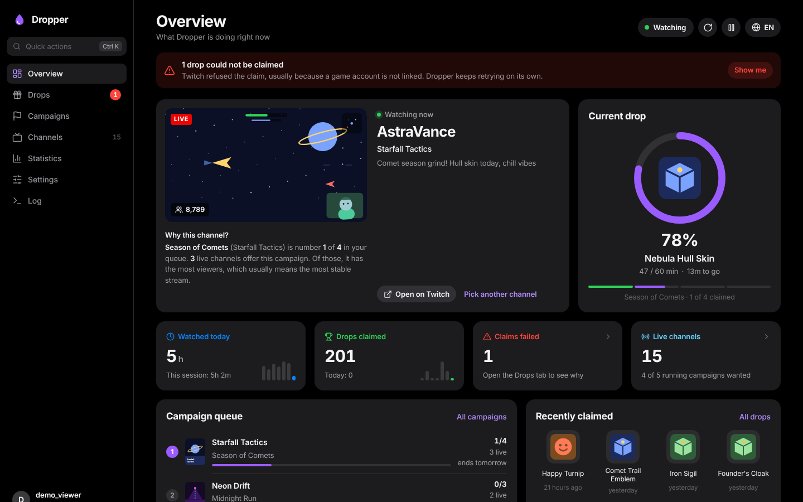
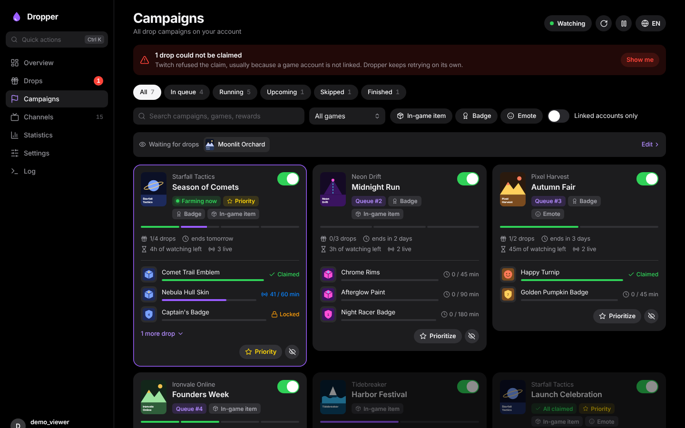
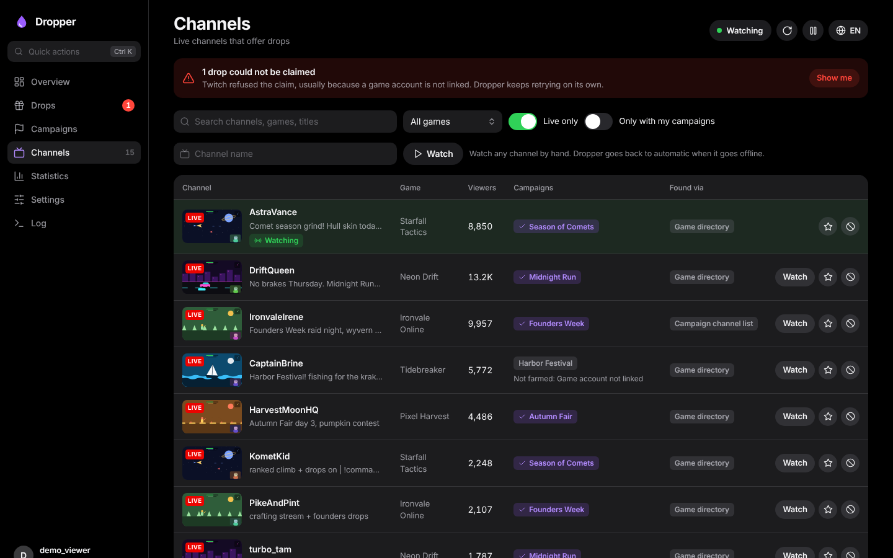
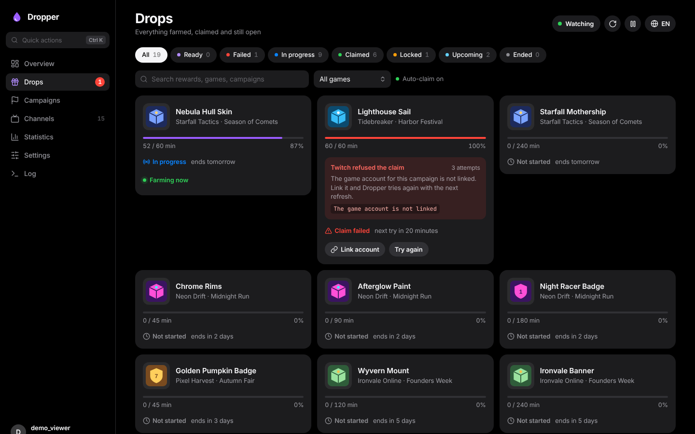
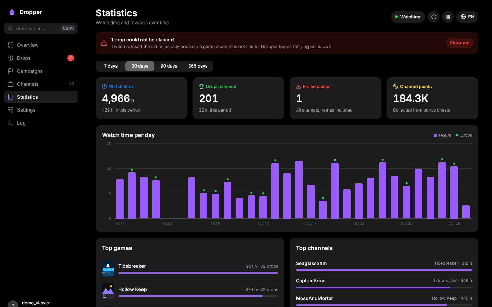

<div align="center">


# Dropper

**Twitch drops, on autopilot.**

A self-hosted Docker container that finds streams with active drops, watches them in the background and claims every reward the moment it is ready, steered from a clean web UI.

[**Live demo**](https://mki002.github.io/dropper-app/demo/) · [Website](https://mki002.github.io/dropper-app/) · [Install](#install) · [Deutsch](README.de.md)

[](https://github.com/MKI002/dropper-app/actions/workflows/ci.yml)
[](https://github.com/MKI002/dropper-app/pkgs/container/dropper-app)
[](LICENSE)

<a href="https://mki002.github.io/dropper-app/demo/"></a>

</div>

> **Try it without installing anything.** The [live demo](https://mki002.github.io/dropper-app/demo/) is the real web UI running on a simulation in your browser, with made-up games, fake live streams and a fast clock, so you can watch drops fill up and get claimed.

## Features

- **Finds the channels for you.** Knows every running campaign ([where they come from](#where-the-campaigns-come-from)), searches each game's directory for streams with drops enabled and asks every channel which campaigns it *really* serves right now. Campaigns limited to certain channels are farmed on exactly those.
- **Claims reliably.** Four independent ways to claim, see [below](#why-claiming-is-reliable). Auto-claim is on by default and can be switched off.
- **Switches on its own.** Picks up new channels and campaigns on every refresh (every 30 minutes by default and exactly when a campaign starts or ends). When a stream goes offline, changes games or stops giving progress, Dropper moves to the next matching channel and shows why it picked it.
- **Your priorities first.** A reorderable priority list that also takes games without a campaign yet ([watch list](#watching-games)), exclude lists, whitelist mode, preferred and blocked channels.
- **Notifications** to Discord or any webhook: drop claimed, claim failed, campaign complete, drops for a watched game, new campaign, login needed. With your own sender name and picture on Discord.
- **No password.** You log in like on a TV by confirming a code on twitch.tv/activate. The session stays in your data folder.
- **Web UI** on port 8080, dark and calm, in 12 languages (English, German, Spanish, French, Italian, Portuguese, Polish, Turkish, Russian, Japanese, Korean, Chinese), and made for phones too. `Ctrl+K` opens quick actions, `1` to `7` switch pages.
- **Extras:** channel points bonus claiming, optional password for the web UI, proxy support, amd64 and arm64 images.

| Campaigns | Channels |
|---|---|
|  |  |
| **Drops** | **Statistics** |
|  |  |

## Install

```yaml
# docker-compose.yml
services:
  dropper:
    image: ghcr.io/mki002/dropper-app:latest
    container_name: Dropper
    restart: unless-stopped
    ports:
      - "8080:8080"
    volumes:
      - ./data:/data
```

```bash
docker compose up -d
```

Or without Compose:

```bash
docker run -d --name Dropper --restart unless-stopped -p 8080:8080 -v "$(pwd)/data:/data" ghcr.io/mki002/dropper-app:latest
```

Open `http://<server>:8080`. On the first start Dropper shows an eight-character code: enter it on <https://www.twitch.tv/activate> and you're done. The login is saved in `data/auth.json` and survives restarts.

To build the image yourself, clone the repo and run `docker compose up -d --build` with the repo's [`docker-compose.yml`](docker-compose.yml).

### Unraid

1. Open *Docker → Add Container*.
2. Fill in:
   - **Name:** `Dropper`
   - **Repository:** `ghcr.io/mki002/dropper-app:latest`
   - **WebUI** (under *Show more settings*): `http://[IP]:[PORT:8080]/`
   - **Icon URL:** `https://raw.githubusercontent.com/MKI002/dropper-app/main/unraid/icon.png`
3. Add with *Add another Path, Port, Variable…*:
   - **Port:** container `8080`, host `8080`
   - **Path:** container `/data`, host `/mnt/user/appdata/dropper`
   - **Variables** `PUID` = `99` and `PGID` = `100`
   - optionally **Variable** `WEBUI_PASSWORD`
4. *Apply*, then click the icon in the Docker tab → *WebUI* and enter the login code on twitch.tv/activate.

Faster with the template: copy [`unraid/dropper.xml`](unraid/dropper.xml) to `\\<server>\flash\config\plugins\dockerMan\templates-user\`. *Dropper* then appears under *Template* in *Add Container*, with everything filled in.

### Coming from PurpleRain

Dropper is the new name of PurpleRain. Your login, settings and statistics carry over as they are:

- **Unraid:** edit the existing container, set **Repository** to `ghcr.io/mki002/dropper-app:latest` and *Apply*. Keep the path `/mnt/user/appdata/purplerain` as it is (renaming the container to `Dropper` is optional). Or stop the old container, move the folder to `/mnt/user/appdata/dropper` and add Dropper from the template.
- **Compose / docker run:** change the image to `ghcr.io/mki002/dropper-app:latest` and keep your `/data` volume.
- The old variables `PURPLERAIN_DATA` and `PURPLERAIN_PROXY` still work; the new names are `DROPPER_DATA` and `DROPPER_PROXY`.

### Environment variables

| Variable | Default | Purpose |
|---|---|---|
| `WEBUI_PASSWORD` | empty | When set, the web UI asks for it (HTTP basic auth) |
| `WEBUI_USER` | `admin` | User name for that |
| `PORT` | `8080` | Port of the web UI |
| `LOG_LEVEL` | `INFO` | `DEBUG` for troubleshooting |
| `TZ` | – | Time zone for the logs |
| `PUID` / `PGID` | `1000` | Owner of the files in `/data` (Unraid: `99` / `100`) |

The container starts as root, hands `/data` to `PUID:PGID` and then runs as that user. Everything else is set in the web UI and stored in `data/settings.json`; statistics live in `data/stats.db` (SQLite).

## Why claiming is reliable

Miners usually miss drops because they rely on a single real-time "drop finished" event. If that event gets lost or the one claim request fails, the drop stays unclaimed. Dropper has four independent ways:

1. **Real time (PubSub):** Twitch reports "drop finished" with a claim ID and the drop is claimed right away.
2. **Progress check:** every minute the current drop's progress is read; once the minutes are reached it is claimed, with or without an event.
3. **Inventory sweep (every 5 minutes by default):** the whole inventory is read and *every* finished but unclaimed drop is claimed, including ones from ended campaigns (up to 24 h later) or other devices.
4. **Retries with a fallback ID:** every claim is retried with backoff. If the reported claim ID is invalid, the ID built from user, campaign and drop is tried. Failures go into the statistics and are retried on the next sweep.

When Twitch refuses a claim (typically an in-game item whose game account is not linked), the Drops tab shows the reason, a link to connect the account and a retry button. Dropper retries after 5, 10, 20, 40 and then every 60 minutes, and right away once the account is linked.

## Notifications

Under *Settings › Notifications*, paste a webhook URL (in Discord: *Server Settings → Integrations → Webhooks → Copy Webhook URL*) and pick what Dropper reports. Events that happen close together arrive as one message, in the language of the web UI. For Discord URLs you can also set the sender's **name** and **profile picture**; other URLs receive JSON with `event`, `text` and the details. *Send test message* tries the URL before you save. The URL is a key to your channel and is stored only in `data/settings.json`.

## Watching games

Any game can go on the priority list (*Settings › Priority list*), also one without drops right now. While you type, Dropper suggests games and checks the name on Twitch for the exact spelling and box art. Each row shows its state: farming, place in the queue, campaign starts on a date, waiting for a campaign, or not found on Twitch. On every refresh Dropper also looks for drops-enabled streams of these games, so a new campaign is noticed as soon as the first channels offer it.

## Where the campaigns come from

Since September 2026 Twitch no longer gives apps the full campaign list, only campaigns already in progress. Dropper fills the gap:

1. **Catalog:** running and upcoming campaigns come from the public [ttvdrops](https://ttvdrops.lovinator.space/) catalog (open data, CC0).
2. **Drops per channel:** for catalog games, Dropper finds live channels and asks Twitch which drops run there. That still works and returns rewards, minutes and time windows.
3. **Inventory:** your progress comes from your Twitch inventory as before.

Twitch doesn't say whether a game account is linked for such campaigns; Dropper then assumes it is and marks the campaign "link status unknown". If Twitch serves the list again, it is used automatically. The catalog URL can be changed or emptied under *Settings › Advanced*.

## How channels are picked

1. Campaigns are filtered: switched-off campaigns, excluded games, whitelist mode, and in-game items without a linked game account (optional) drop out. Badges and emotes need no link.
2. Order: your priority list first, then either "ending soonest" or "least spare time" (time left divided by minutes still needed).
3. Dropper watches the first campaign that has a matching live channel: preferred channels first, then the campaign's own channel list, then by viewers. It stays on the current channel while it still serves that campaign.
4. If there is no progress for 12 minutes, the channel is paused for 30 minutes and the next one is used.

Twitch counts drop progress for one stream per account at a time, so Dropper watches one channel, not several in parallel.

## When Twitch changes something

Twitch identifies API queries by hashes that change now and then. Dropper knows several hashes for the important queries and switches on `PersistedQueryNotFound`. If a query still fails, enter the new hash under *Settings › Advanced › GQL hash overrides*, no new image needed. The defaults are in [`dropper/constants.py`](dropper/constants.py).

## Development

```bash
python -m venv .venv && . .venv/bin/activate
pip install -r requirements-dev.txt
pytest
DROPPER_DATA=./data python -m dropper
```

The API docs are at `/api/docs`.

| Path | What's in it |
|---|---|
| `dropper/twitch.py` | HTTP, device-code login, GQL with retry and rate limit |
| `dropper/catalog.py` | Public campaign catalog, standing in for the gated Twitch list |
| `dropper/models.py` | Campaigns, drops, channels |
| `dropper/selection.py` | Filters and channel choice (no I/O, tested) |
| `dropper/miner.py` | The loop: load, search, watch, claim |
| `dropper/pubsub.py` | Real-time events |
| `dropper/stats.py` | SQLite statistics |
| `dropper/web.py` | REST API |
| `dropper/static/` | Web UI without a build step: `js/app.js` (pages), `js/i18n.js` (languages), `js/fx.js` (effects), `css/app.css`, `locales/*.json` |
| `site/` | GitHub Pages: landing page and the live demo (`demo/demo.js` simulates the API in the browser) |

New UI texts go into `locales/en.json` first and then into every other language file; `tests/test_locales.py` checks that no translation, placeholder or plural form is missing.

To preview the website and demo locally: `python site/build.py && python -m http.server -d _site`.

The Twitch integration (Android TV client login, watch events, GQL operations) follows the approach of [TwitchDropsMiner](https://github.com/DevilXD/TwitchDropsMiner) and [Twitch-Channel-Points-Miner](https://github.com/0x8fv/Twitch-Channel-Points-Miner).

## License

[MIT](LICENSE). Dropper is not affiliated with or endorsed by Twitch. Use it at your own risk and in line with Twitch's terms.
